# RepoLens Architecture

RepoLens is a standalone Chromium Manifest V3 extension built with TypeScript, React 19, Tailwind CSS, Vite, and esbuild. All repository acquisition, heuristic indexing, AI orchestration, caching, and rendering run locally inside the extension with no backend proxy.

---

## 1. Manifest V3 Extension Topology

Defined in [extension/manifest.json](../extension/manifest.json) and built via [vite.config.ts](../vite.config.ts):

- **Background Service Worker (`src/background/index.ts` -> `dist/background.js`):**
  - Bundled as an ES module (`"type": "module"`).
  - Calls `chrome.sidePanel.setPanelBehavior({ openPanelOnActionClick: true })` so clicking the extension action opens the side panel.
  - Maintains an ephemeral `tabRepoMap` (`Map<number, RepoIdentity>`) keyed by Chrome tab ID and cleans entries on `chrome.tabs.onRemoved`.
  - Listens for `REPO_DETECTED` messages from content scripts (deriving/validating identity via `sender.tab.url`) and `GET_CURRENT_REPO` queries from the side panel (re-validating active or requested tab URLs via `parseGitHubUrl` and clearing stale entries when navigating away from GitHub).
- **Content Script (`src/content/index.ts` -> `dist/content.js`):**
  - Bundled separately via `esbuild` as a standalone IIFE (`format: 'iife'`) because MV3 content scripts cannot load external ES module chunks cleanly without web-accessible resource configuration.
  - Injected on `https://github.com/*` at `document_idle`.
  - Parses `window.location.href` with `parseGitHubUrl()`, deduplicates consecutive identical payloads, and sends `{ type: 'REPO_DETECTED', payload }` to the background service worker.
  - Listens for `turbo:load`, `turbo:render`, `popstate`, and monkey-patches `history.pushState` / `history.replaceState` to catch GitHub SPA navigations.
- **Side Panel Application (`src/sidepanel/index.html` -> `dist/sidepanel/index.html`):**
  - React 19 UI rooted in [src/sidepanel/index.tsx](../src/sidepanel/index.tsx) and [src/sidepanel/App.tsx](../src/sidepanel/App.tsx).
  - Queries `GET_CURRENT_REPO` on mount and subscribes to `chrome.runtime.onMessage` (`REPO_DETECTED`), `chrome.tabs.onActivated`, and `chrome.tabs.onUpdated`.

---

## 2. Data Flow

```mermaid
flowchart LR
    GH["GitHub Tab (github.com)"] -->|"URL & Turbo/History events"| CS["Content Script (content.js)"]
    CS -->|"REPO_DETECTED (RepoIdentity)"| BG["Background Service Worker (background.js)"]
    BG -->|"GET_CURRENT_REPO"| SP["Side Panel App (App.tsx)"]
    SP -->|"Check owner/repo:commitSha"| CACHE["RepoCache (chrome.storage.local)"]
    SP -->|"Metadata, Tree, Raw Files"| GHAPI["GitHubClient (api.github.com)"]
    GHAPI -->|"GitTreeItem[] + RepoMetadata"| IDX["Indexer & Prioritizer"]
    IDX -->|"RepoIndex + Bounded File Slice"| ENG["AnalysisEngine (Stages 1-3 & Q&A)"]
    ENG -->|"Structured JSON / SSE Stream"| AI["GeminiProvider / OpenAIProvider"]
    AI -->|"Overview / Architecture / Explorer / Chat"| SP
    ENG -->|"Per-stage Save"| CACHE
```

1. **Detection:** The user navigates on `github.com`. `content.js` extracts `RepoIdentity` and notifies `background.js`.
2. **Hydration:** `App.tsx` requests `GET_CURRENT_REPO`. If `commitSha` is present in the URL and exists in `RepoCache`, cached results hydrate immediately.
3. **Acquisition:** Clicking **Analyze** calls `GitHubClient.getRepoMetadata()`, `GitHubClient.getTree()` (recursive), and `GitHubClient.getCommitSha()` (when `identity.commitSha` is not already in the URL) to anchor `resolvedSha` to the true 40-character commit SHA.
4. **Indexing:** `buildRepoIndex()` excludes noise/secrets, detects languages, locates manifests and candidate entry points, scores files, and renders a tree outline.
5. **Progressive Analysis:** `AnalysisEngine` executes 3 sequential stages (`Overview` → `Architecture & Execution Flow` → `Codebase Explorer`), fetching bounded file contents (`fetchBoundedContents`) and saving each completed stage to `RepoCache`.
6. **Interactive Exploration & Q&A:** Users inspect clickable GitHub source citations across tabs or stream follow-up questions through `AnalysisEngine.askQuestion()`.

---

## 3. Core Module Breakdown

### URL Parser ([src/core/github/url-parser.ts](../src/core/github/url-parser.ts))
- Exports `parseGitHubUrl(url: string): RepoIdentity | null`.
- Validates `github.com` / `www.github.com` hostnames, filters reserved non-repository top-level paths (`settings`, `explore`, `marketplace`, `trending`, `orgs`, `search`, etc.), strips trailing `.git`, detects 40-character hex commit SHAs, and classifies `pageType` (`repo_root`, `tree`, `blob`, `pull`, `issues`, `other`).

### GitHub API Client ([src/core/github/client.ts](../src/core/github/client.ts))
- `GitHubClient` wraps `fetch` against `https://api.github.com` with an optional Bearer PAT:
  - `getRepoMetadata(owner, repo)` → `RepoMetadata` (`defaultBranch`, `description`, `isPrivate`, `language`).
  - `getTree(owner, repo, ref)` → `GitTreeResponse` (`sha`, `tree`, `truncated` boolean).
  - `getFileContent(owner, repo, path, ref)` → raw file text via `Accept: application/vnd.github.v3.raw` with path-segment encoding.
- Maps HTTP failures to `RateLimitError` (429 or 403 rate-limit responses with `remaining` and `resetTimestamp`), `NotFoundError` (404), and `GitHubApiError`.

### Prioritizer & Indexer ([src/core/indexer/prioritizer.ts](../src/core/indexer/prioritizer.ts), [src/core/indexer/indexer.ts](../src/core/indexer/indexer.ts))
- `isExcluded(path, type)` filters:
  - Noise/build directories (`node_modules`, `.git`, `dist`, `build`, `out`, `target`, `vendor`, `.idea`, `.vscode`, `coverage`, `__pycache__`, `.next`, `.nuxt`).
  - Secret files (`.env*` except `.env.example`), lockfiles (`package-lock.json`, `yarn.lock`, `pnpm-lock.yaml`, `Cargo.lock`, `poetry.lock`, `composer.lock`, `Gemfile.lock`), minified/source-map assets (`.min.js`, `.min.css`, `.map`), and binary/media extensions.
- `getFilePriorityScore(path)` ranks manifests (`90–100`), READMEs (`85–95`), candidate entry points in root/`src/` (`80`), config files (`65–70`), shallow sources (`55`), and deeper source files (`10–45`).
- `prioritizeTree(tree, maxPrioritized = 20)` returns top prioritized paths, manifests, and candidate entry points.
- `generateTreeOutline(tree, maxDepth = 3)` builds a deterministic directory-first outline string.
- `buildRepoIndex` (aliased as `extractRepoIndex`) produces the serializable `RepoIndex`.

### AI Provider Layer ([src/core/ai/types.ts](../src/core/ai/types.ts), [src/core/ai/gemini-provider.ts](../src/core/ai/gemini-provider.ts), [src/core/ai/openai-provider.ts](../src/core/ai/openai-provider.ts))
- `AIProvider` interface defines:
  - `generateStructured<T>(prompt, schema, systemInstruction?)`
  - `streamChat(messages, onChunk, systemInstruction?)`
- `GeminiProvider`: calls `generativelanguage.googleapis.com/v1beta/models/<model>:generateContent` (`responseMimeType: 'application/json'`, `responseSchema`) and `:streamGenerateContent?alt=sse`, translating `assistant` messages to `model` role.
- `OpenAIProvider`: calls `api.openai.com/v1/chat/completions` with `response_format: { type: 'json_schema' }` for structured outputs and `stream: true` SSE deltas for chat.
- `AIProviderError` normalizes 401/403, 429, and 5xx HTTP errors into `friendlyMessage` strings.

### Progressive Explanation Engine ([src/core/ai/engine.ts](../src/core/ai/engine.ts))
- `AnalysisEngine` isolates all prompt construction and JSON schemas (`OVERVIEW_SCHEMA`, `ARCHITECTURE_SCHEMA`, `EXPLORER_SCHEMA`) from React components:
  - `runStage1Overview(index, readmeSnippet, manifestContents)` → `OverviewOutput`
  - `runStage2Architecture(index, overview, entryContents)` → `ArchitectureOutput`
  - `runStage3Explorer(index, architecture)` → `CodebaseExplorerOutput`
  - `askQuestion(index, context, history, onChunk)` → streamed Markdown answer
- Wraps all repository data via `wrapRepositoryData()` inside `<repository_data>` delimiters paired with `SYSTEM_SECURITY_INSTRUCTION`.

### Commit-Aware Storage & Cache ([src/core/storage/cache.ts](../src/core/storage/cache.ts), [src/core/storage/settings.ts](../src/core/storage/settings.ts))
- `RepoCache`: stores `CachedAnalysis` (`commitSha`, `timestamp`, `repoIndex`, `overview`, `architecture`, `explorer`) under `repolens:v1:<owner>/<repo>:<commitSha>` in `chrome.storage.local` (with an in-memory `Map` fallback for non-extension test environments). Validates `entry.commitSha === commitSha` on read and supports partial-stage updates and prefix-based clearing.
- `SettingsStore`: manages `UserSettings` (`aiProvider`, `geminiApiKey`, `geminiModel`, `openaiApiKey`, `openaiModel`, `githubToken`) under `repolens:settings` in `chrome.storage.local`.

### Side Panel UI & Tab Workflows ([src/sidepanel/App.tsx](../src/sidepanel/App.tsx))
- `App.tsx` coordinates state, `fetchBoundedContents` (15,000 chars/file, 55,000 chars max per batch), stale-run cancellation via `activeRunIdRef`, and per-stage progressive updates across 5 tabs:
  - `Header.tsx`: repo identity link, branch/SHA badges, status pill (`idle`, `detecting`, `indexing`, `analyzing`, `ready`, `error`), `cached` badge, Analyze/Refresh button, Settings trigger.
  - `OverviewTab.tsx`: Purpose, categorized Tech Stack with clickable citations, Key Modules, Execution Summary, Key Observations.
  - `ArchitectureTab.tsx`: Pattern badge, interactive Component Cards with dependency navigation and reverse "Used by" links, Data Flow, External Integrations.
  - `CodebaseExplorerTab.tsx`: Significance filter pills (`all`, `critical`, `important`, `supporting`), grouped path cards with rationale, collapsible `Tree Outline`.
  - `ExecutionFlowTab.tsx`: Ordered timeline steps with `verified`/`inferred` badges, line-range links, and snippets.
  - `AskRepositoryTab.tsx`: Streaming Q&A with preset question chips, XSS-safe Markdown rendering (`utils.ts`), clickable file citations, and unmount/repo-switch stale-stream protection.
  - `SettingsModal.tsx`: Credential and model configuration, local-storage privacy disclosure, and `Clear Cache`.
